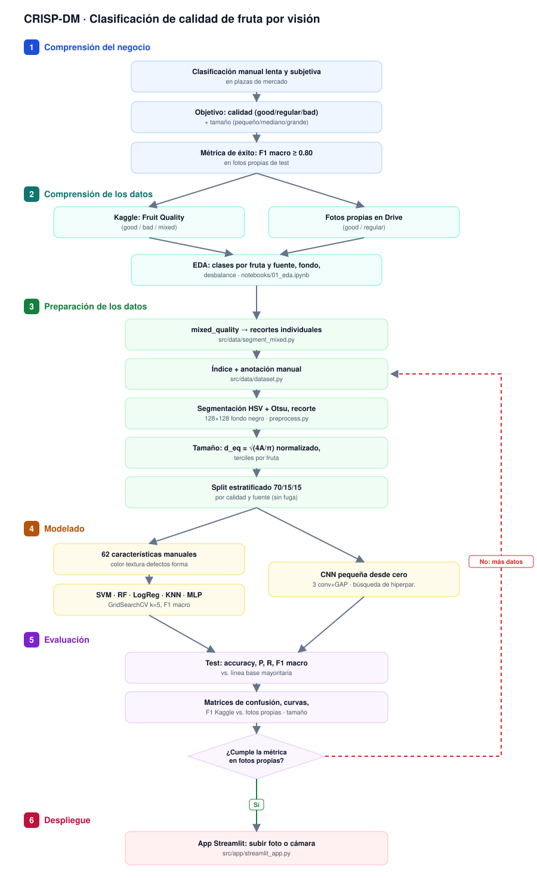
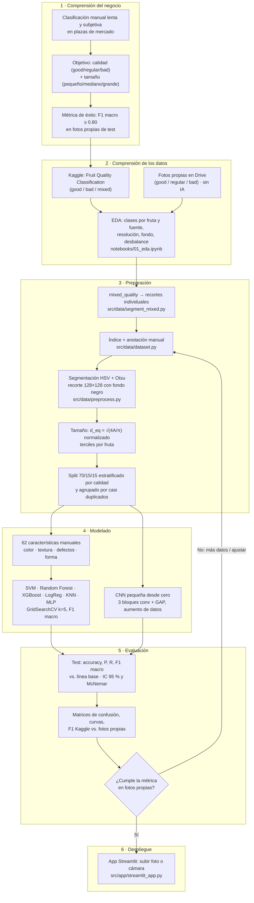

# CRISP-DM aplicado al proyecto

> La consigna pide un **diagrama de flujo propio**, no el diagrama genérico de CRISP-DM. Este diagrama muestra lo que hace cada fase del proyecto y en qué script está. GitHub dibuja el mermaid de abajo automáticamente; el **export vectorial para el informe** está en [`docs/figuras/crisp_dm.svg`](figuras/crisp_dm.svg) (se regenera con `python scripts/gen_crisp_svg.py`).

## Evidencia por fase

| Fase | Pregunta que responde | Evidencia en el repo |
|------|-----------------------|----------------------|
| Negocio | ¿Por qué importa clasificar calidad? | `report/informe.md` §Introducción, `docs/etica_impactos.md` |
| Datos | ¿Qué datos hay y qué problemas tienen? | `notebooks/01_eda.ipynb`, `data/processed/index.csv` |
| Preparación | ¿Cómo quedan listos para modelar? | `src/data/*`, `docs/datos.md`, `data/anotaciones_propias.csv` |
| Modelado | ¿Qué modelos y con qué hiperparámetros? | `src/models/*`, `src/training/*`, `experiments/results/cv_*.csv` |
| Evaluación | ¿Qué tan bien funcionan y dónde fallan? | `experiments/results/comparacion_modelos.csv`, `docs/figuras/*.svg` |
| Despliegue | ¿Cómo lo usa una persona? | `src/app/streamlit_app.py`, video de demostración |
